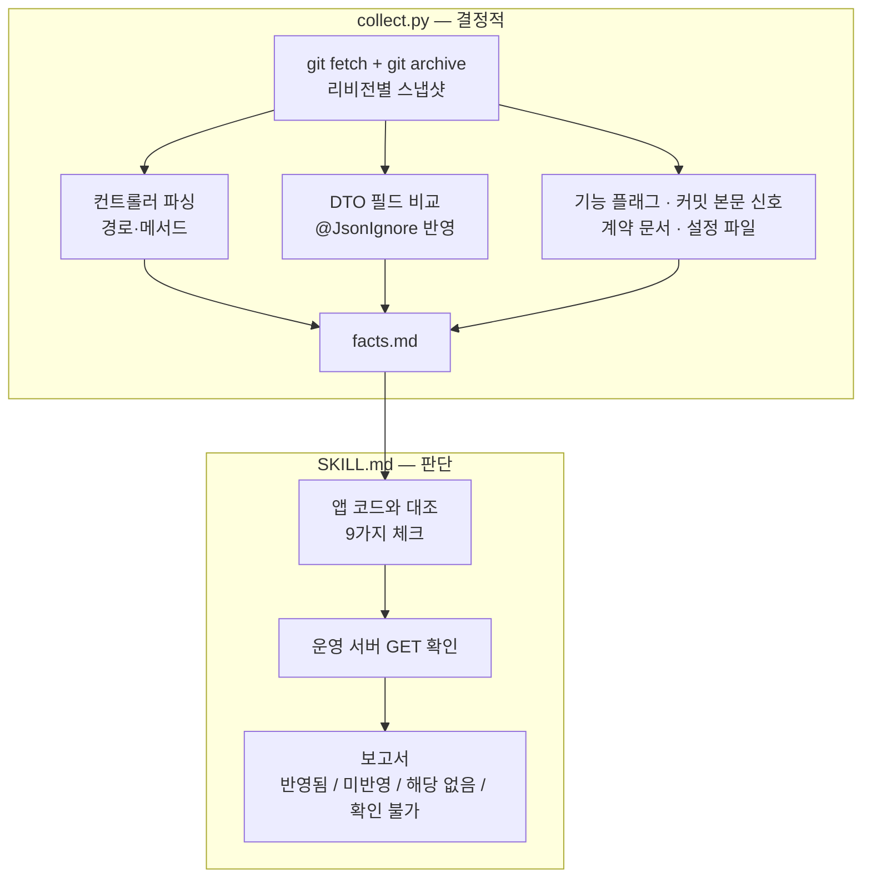

## 요약

- 서버 저장소에 커밋이 쌓이면 "앱에 반영할 게 있나?"를 매번 사람이 읽어야 했습니다. 이 일을 **AI 코딩 에이전트(Claude Code)의 스킬**로 만들었습니다.
- 핵심은 역할 분리입니다. **결정적인 사실 수집은 스크립트**가 하고, **앱 코드와 대조하는 판단은 AI** 가 합니다.
- 같은 질문 3개로 스킬 사용·미사용을 비교했습니다. 검증 항목 통과율은 **84% → 100%** 였고, 시간은 약 26%, 토큰은 약 31% 줄었습니다.

## 배경

푸차는 서버 하나에 앱 두 개(고객·사장)가 붙어 있습니다. 서버가 바뀌면 앱이 깨지는데, [5편](/posts/api-contract-ci/)에서 말했듯 그 깨짐은 대개 "빈 화면"으로 나타납니다. 그래서 서버 커밋이 올라오면 다음을 확인해야 했습니다.

- 앱이 부르는 경로가 사라지거나 HTTP 메서드가 바뀌었는가
- 응답 JSON 필드의 타입이 바뀌었는가
- 기능 플래그로 꺼질 수 있는 API 를 앱이 그냥 부르는가
- 서버 작성자가 커밋 본문에 남긴 "앱 후속 작업"이 있는가
- 서버 폴더 구조가 바뀌어 앱 CI 가 깨지는가

AI 에게 "서버 커밋 보고 앱 영향 알려줘"라고만 해도 어느 정도는 합니다. 하지만 매번 결과가 다르고, 중요한 것을 빠뜨렸습니다.

## 설계: 사실은 스크립트, 판단은 AI

| 단계 | 누가 | 이유 |
|---|---|---|
| 비교할 커밋 범위 고르기, 소스 스냅샷, 경로·필드 추출 | 스크립트 | 매번 같아야 하고, AI 가 하면 느리고 빠뜨린다 |
| "앱이 이미 대응했나" 판단, 근거(파일:줄) 찾기 | AI | 앱 코드는 형태가 다양해 규칙으로 쓰기 어렵다 |
| 다음 실행의 기준점 기록 | 스크립트 | 같은 커밋을 다시 보지 않게 |

스크립트는 저장소를 **읽기만** 합니다. 작업 트리를 바꾸지 않고 `git archive` 로 스냅샷을 만들고, AI 도 그 스냅샷만 읽게 했습니다. 서버 작업 트리는 다른 브랜치일 수 있기 때문입니다.

## 지식을 문서로: 실제로 겪은 함정 목록

AI 가 같은 실수를 반복하지 않도록, 이 프로젝트에서 **실제로 틀렸던 사례**를 `pitfalls.md` 로 정리해 스킬에 넣었습니다.

- 파서가 못 읽은 매핑 때문에 생기는 "서버에 없음" 오탐
- **엔티티 변화 ≠ JSON 변화**: 엔티티의 좌표가 `String → Double` 이 돼도 응답 DTO 가 `String` 이면 앱 영향은 없습니다. 반대로 엔티티를 그대로 직렬화하는 응답은 `5000.0 → 5000` 으로 JSON 이 바뀝니다.
- **main ≠ 운영**: main 에 생긴 API 를 앱이 바로 쓰면 운영에서 깨집니다.
- 기능 플래그가 꺼지면 컨트롤러가 아예 뜨지 않아 404 가 납니다. 버그가 아닙니다.

이 문서가 일반적인 프롬프트보다 효과가 컸습니다. "조심해"가 아니라 "이 코드베이스에서 이렇게 틀렸다"를 알려주기 때문입니다.

## 평가: 정말 나아졌나

스킬은 만들기보다 **나아졌다는 것을 확인하기**가 어렵습니다. 그래서 실제로 있었던 질문 3개로 평가 세트를 만들었습니다.

| 평가 케이스 | 묻는 것 |
|---|---|
| 알려진 구간 | 이미 사람이 분석한 커밋 범위 — 정답과 비교 |
| 통합 브랜치 머지 위험 | 아직 머지되지 않은 큰 브랜치가 들어가면 무엇이 깨지나 |
| 최근 변경 | 처음 받았던 질문 그대로 |

케이스마다 "반드시 짚어야 할 것" 목록(채점 기준)을 만들고, 스킬 사용·미사용 두 조건으로 같은 모델을 돌려 채점했습니다.

| 지표 | 스킬 사용 | 미사용 |
|---|---|---|
| 채점 기준 통과율 | **100%** | 84% |
| 소요 시간(평균) | **311초** | 423초 |
| 토큰(평균) | **12.5만** | 18.1만 |

가장 큰 차이는 **앱 CI 가 깨진다는 사실**을 찾았느냐였습니다. 통합 브랜치가 서버 폴더 구조를 바꾸는데, 스킬은 체크리스트에 따라 앱의 계약 대조 스크립트를 그 스냅샷으로 **직접 돌려 보고** 실패를 확인했습니다. 스킬이 없는 쪽은 경로·필드 분석은 잘했지만 이 점을 놓쳤습니다.

## 한계

- 평가 세트가 3개, 조건마다 1회 실행입니다. 경향은 보이지만 통계적으로 단단한 결론은 아닙니다. 새 서버 변경이 생길 때마다 케이스를 늘리고 있습니다.
- 파서는 여전히 정규식입니다. `@org.springframework…PatchMapping` 처럼 패키지명을 붙인 어노테이션을 놓치는 버그를 알고 있습니다.
- 설정값 변화(예: 업로드 최대 픽셀 80MP → 20MP)는 아직 자동으로 비교하지 않습니다. AI 가 커밋을 읽다가 찾았지만, 스크립트로 옮길 다음 대상입니다.

## 마치며

AI 도구를 만들 때 가장 도움이 된 원칙은 두 가지였습니다. **AI 가 잘 못하는 일(결정적 수집)은 코드에 맡기고**, **도구가 나아졌다는 주장은 평가로 확인한다.** 두 번째 원칙이 없었다면 "써 보니 좋더라"에서 멈췄을 것입니다.
