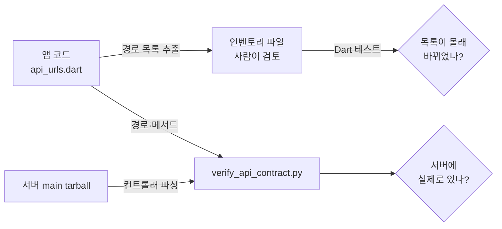

## 요약

- 1년이 안 되는 사이에 API 서버 구조가 세 번 바뀌었습니다: **한 저장소 → 고객·사장·관리자 세 서버 → 모노레포 → 고객·사장 통합 앱**.
- 앱이 다른 서버에만 있는 경로를 부르면 404 가 나지만, 화면에는 오류가 아니라 **"데이터 없음"** 으로 보입니다. 사용자도 개발자도 알아채기 어렵습니다.
- 앱 CI 가 **서버 소스를 받아 앱의 모든 API 경로·메서드가 실제로 있는지 대조**하게 했습니다. 서버 구조가 바뀔 때마다 대조 도구도 함께 바꿨습니다.

## 문제: 404 는 빈 화면이다

모바일 앱의 목록 화면은 보통 이렇게 생겼습니다.

```dart
final stores = response.data['data'] ?? [];   // 실패하면 빈 목록
```

방어적으로 쓴 코드가 오히려 문제를 숨깁니다. 서버를 셋으로 나눈 날, 고객앱이 사장 서버에만 남은 경로를 부르면 **로그인은 되는데 그다음이 전부 비어 있는** 상태가 됩니다. 크래시도 에러 로그도 없습니다.

## 두 겹의 검사



| 검사 | 질문 | 필요한 것 |
|---|---|---|
| Dart 테스트 | 앱이 부르는 경로 목록이 사람이 검토한 인벤토리와 같은가 | 앱 저장소만 |
| 계약 대조 스크립트 | 그 경로·HTTP 메서드가 서버 컨트롤러에 실제로 있는가 | 서버 소스 |

CI 는 서버 저장소의 main 을 **tarball 로 받아** 대조합니다. 처음에는 `actions/checkout` 으로 받았는데, 서버 저장소의 서브모듈 설정 때문에 실패해서 tarball 로 바꿨습니다.

## 서버 구조가 바뀔 때마다

대조 스크립트는 서버의 스프링 컨트롤러를 정규식으로 읽어 `경로 → 메서드` 표를 만듭니다. 서버 폴더 구조가 바뀌면 이 스크립트가 가장 먼저 깨집니다.

| 시기 | 서버 구조 | 대조 도구 |
|---|---|---|
| ~2026-09 | 한 저장소(`src/main/java`) | 기준 |
| 2026-09 | 고객·사장·관리자 세 저장소 | 고객 서버만 대조 |
| 2026-10 | 모노레포 `apps/{customer,vendor,admin}` | 두 구조를 모두 읽게 수정 |
| 진행 중 | `apps/api` 하나가 고객·사장을 함께 서빙 | **대응 필요** — 아래 참고 |

통합 앱에서는 같은 경로를 고객과 사장이 함께 쓰고, nginx 가 붙이는 `X-Pucha-Client-App` 헤더로 둘을 구분합니다. 컨트롤러 이름(`Customer*`, `Vendor*`)이 더 이상 "누가 쓰는지"를 뜻하지 않으므로, 대조할 때 두 표면을 합쳐서 봐야 합니다.

## 정규식 파서가 틀린 세 가지

컨트롤러를 정규식으로 읽으면 빠르지만 오탐이 납니다. 실제로 겪은 것들입니다.

1. `@RequestMapping(value = "/refresh", method = {POST, GET})` 형태를 못 읽어 refresh 가 **"없음"** 으로 나왔습니다.
2. 주석 속 `@RequestMapping 이 없어…` 라는 문장을 매핑으로 읽어 `/` 경로가 생겼습니다. 주석을 먼저 지워서 해결했습니다.
3. `@Tag(description = "…/{storeId}…")` 문자열 속 `{` 때문에 클래스 수준 접두사를 잃어서, `/v1/store/*` 전체가 **"삭제"** 로 나왔습니다. 문자열 리터럴을 비우고 판별해서 해결했습니다.

오탐은 CI 를 "늑대 소년"으로 만듭니다. 한 번 무시하기 시작하면 진짜 실패도 무시하게 되므로, 오탐을 고치는 데 시간을 아끼지 않았습니다.

## 서버보다 앱이 앞설 때: AHEAD_OF_SERVER

앱이 서버에 아직 없는 경로를 먼저 부르는 경우도 있습니다. 예를 들어 기기 해제 API 는 앱이 먼저 배포되고 서버가 나중에 열었습니다. 이때 CI 를 통과시키되 기록을 남기는 목록을 둡니다.

```python
AHEAD_OF_SERVER = {
    # "DELETE /v1/app/devices/{id}": "서버 배포 대기 — 호출부가 404 를 무시하는 베스트에포트",
}
```

규칙은 두 가지입니다. 호출부가 404 를 견디는 경우에만 올리고, 서버에 생기면 바로 지웁니다. 목록이 비어 있는 것이 정상 상태입니다.

## 결과

- 앱이 서버에 없는 경로를 부르는 변경은 **머지 전에 CI 에서 실패**합니다. "배포 후 빈 화면으로 발견"이 "PR 에서 빨간 불로 발견"으로 바뀌었습니다.
- 서버 구조 변경이 앱 CI 를 깨뜨리면, 그 사실이 서버 변경 영향 보고서에 가장 먼저 올라옵니다([6편](/posts/ai-api-impact-agent/)).

> 운영 기간 동안의 장애 건수 같은 수치는 측정하지 않았습니다. 이 단락은 검사가 **무엇을 막도록 설계됐는지**에 대한 설명입니다.

## 한계

- 이 검사는 **경로와 메서드만** 봅니다. JSON 필드의 타입 변화(예: `double` → `int`)는 잡지 못합니다. 이 부분은 서버 DTO 를 비교하는 별도 도구가 맡습니다.
- 대조 기준이 서버 **main** 입니다. 운영에 배포된 서버가 main 보다 뒤처질 수 있다는 점은 CI 가 알 수 없습니다(그래서 [3편](/posts/refresh-token-rotation-405-fallback/)의 405 폴백이 필요했습니다).
- 통합 앱 구조(`apps/api`)는 아직 대조 도구에 반영하지 않았습니다. 서버 통합 브랜치가 main 에 들어가기 전에 고쳐야 할 목록에 올라 있습니다.

## 마치며

"서버에 그 경로가 있나?"는 너무 당연해서 확인하지 않는 질문입니다. 그런데 구조가 바뀌는 시기에는 이 질문이 가장 자주 틀립니다. 당연한 것을 기계가 매번 확인하게 해 두면, 구조를 과감하게 바꿀 수 있습니다.
