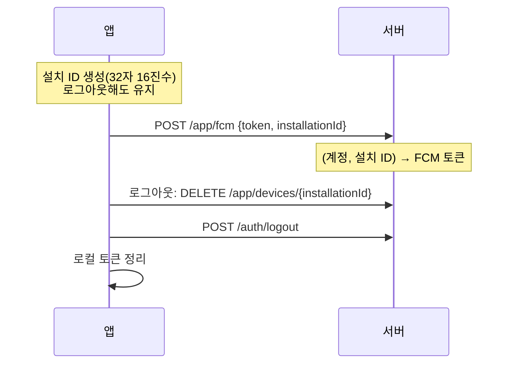

## 요약

- 모바일 네트워크에서 요청은 **두 번 가고**, 알림은 **두 번 오고**, 로그아웃한 기기에도 **알림이 옵니다.** 서버만 고쳐서도, 앱만 고쳐서도 막을 수 없습니다.
- 서버와 앱이 **계약 문서 하나**를 두고 함께 고쳤습니다.
  - 주문 생성에는 **멱등 키**를 둡니다.
  - 푸시에는 **eventId** 를 둡니다.
  - 기기 등록에는 **설치 ID** 를 둡니다.
  - 환불 보류는 **상태(REFUND_PENDING)** 로 표시합니다.
- 서버가 바뀐 계약은 선택 필드로 열어 두고, 앱이 따라오는 순서로 진행해 **어느 쪽이 먼저 배포돼도 깨지지 않게** 했습니다.

## 배경: 계약 문서로 일하기

푸차의 서버는 변경이 앱에 영향을 줄 때 `app-contract-changes` 문서에 항목(B1, B2 …)을 남깁니다. 항목마다 서버가 무엇을 바꿨는지와 고객앱·사장앱이 각각 무엇을 해야 하는지를 표로 적습니다. 이번 글은 그중 B3·B4 묶음을 앱에 반영한 이야기입니다.

## 1. 중복 주문 — 멱등 키

### 문제

주문 버튼을 누르고 응답이 늦으면 사용자는 한 번 더 누릅니다. 응답이 유실되면 앱이 재시도합니다. 서버 입장에서는 둘 다 "새 주문"입니다.

### 해결

앱이 주문 본문마다 **멱등 키**(32자리 16진수)를 붙입니다.

| 상황 | 키 | 서버 응답 |
|---|---|---|
| 같은 본문 재전송(더블탭·재시도) | 같은 키 | 기존 주문을 그대로 반환 |
| 사용자가 장바구니를 바꿈 | 새 키 | 새 주문 |
| 같은 키에 다른 본문 | — | 409 (클라이언트 버그로 간주) |
| 주문이 만들어짐 | 다음 주문은 새 키 | — |

"같은 본문이면 같은 키"가 핵심입니다. 키를 버튼을 누를 때마다 새로 만들면 더블탭을 막지 못하고, 화면에 들어올 때 한 번만 만들면 장바구니를 바꾼 뒤의 주문이 409 가 됩니다.

## 2. 환불 보류 — 성공 응답만 믿지 않기

### 문제

결제사(PG) 환불이 보류되면 서버는 취소 요청에 **성공으로 응답**하고 주문 상태를 `REFUND_PENDING` 으로 둡니다. 앱은 응답만 보고 "주문이 취소되었어요"라고 안내했고, 목록에는 `REFUND_PENDING` 이라는 영문 상태가 그대로 찍혔습니다.

### 해결

- 상태 배지를 "환불 진행 중"으로 표시하고, 진행 중 필터에 넣었습니다.
- 취소 후 **주문을 다시 조회**해 `CANCELLED` 일 때만 "취소되었어요"라고 안내합니다. 그 외(재조회 실패 포함)는 "환불 진행 중"으로 안내합니다. 확실하지 않으면 보수적으로 말합니다.

## 3. 같은 알림이 두 번 — eventId

### 문제

서버의 주문 알림은 기기별 outbox 에 쌓였다가 **at-least-once** 로 발송됩니다. 발송 성공 여부를 확신할 수 없으면 다시 보내는 방식이라, 앱이 포그라운드일 때 같은 알림이 두 번 뜰 수 있습니다.

### 해결

서버가 payload 에 `eventId` 를 싣고, 앱은 **최근 50개의 eventId** 를 기억해 이미 본 알림을 거릅니다. 로컬 알림 ID 도 eventId 로 정해서, 같은 알림이 두 번 와도 알림 센터에 한 줄만 남게 했습니다.

at-least-once 와 클라이언트 중복 제거의 조합은 메시지 시스템의 정석입니다. 서버에 "정확히 한 번"을 요구하는 것보다 훨씬 단순합니다.

## 4. 로그아웃했는데 알림이 온다 — 설치 ID

### 문제

FCM 토큰은 **기기(앱 설치)** 에 매여 있고 계정과는 무관합니다. 로그아웃해도 서버에는 "이 FCM 토큰 = 이전 계정"이 남아, 이전 계정의 주문 알림이 계속 왔습니다.

### 해결

- 앱 설치마다 **설치 ID** 를 만들어 보관합니다. 로그아웃해도 지우지 않습니다. 같은 기기를 다시 등록할 때 같은 행을 갱신하기 위해서입니다.
- 로그아웃 순서는 **기기 해제 → 토큰 폐기 → 로컬 정리**입니다. 기기 해제에는 access 토큰이 필요하기 때문입니다.
- 서버 호출 두 개는 **베스트에포트**입니다. 오프라인이어도 로그아웃 버튼은 반드시 동작해야 합니다.

사장앱은 같은 서버의 같은 경로를 씁니다. 그래서 nginx 가 사장 호스트로 들어온 요청에 `X-Pucha-Client-App: vendor` 헤더를 붙이고, 서버가 이 헤더로 고객 기기와 사장 기기를 구분합니다. 이 헤더는 클라이언트가 위조하지 못하도록 nginx 가 항상 덮어씁니다.

## 배포 순서를 독립적으로

이 계약들은 모두 **서버가 먼저 선택 필드로 열고, 앱이 따라오는** 순서로 진행했습니다.

| 서버만 배포된 상태 | 앱만 배포된 상태 |
|---|---|
| 멱등 키 없는 옛 앱 → 서버는 키 없이 기존처럼 처리 | 새 앱이 키를 보냄 → 옛 서버는 모르는 필드를 무시 |
| eventId 를 모르는 옛 앱 → 중복이 보일 뿐 동작 | 새 앱이 기기 해제 호출 → 옛 서버 404, 앱은 무시하고 진행 |

모바일 앱은 사용자가 업데이트하지 않으면 옛 버전이 계속 돕니다. "양쪽 버전이 섞여도 동작"은 선택이 아니라 필수입니다.

## 마치며

"두 번"은 버그가 아니라 분산 시스템의 기본값입니다. 서버와 앱 중 어느 한쪽에서 완벽하게 막으려 하기보다, 계약 문서 하나로 **책임을 나눠 각자 쉬운 쪽에서** 막는 것이 효과적이었습니다.
