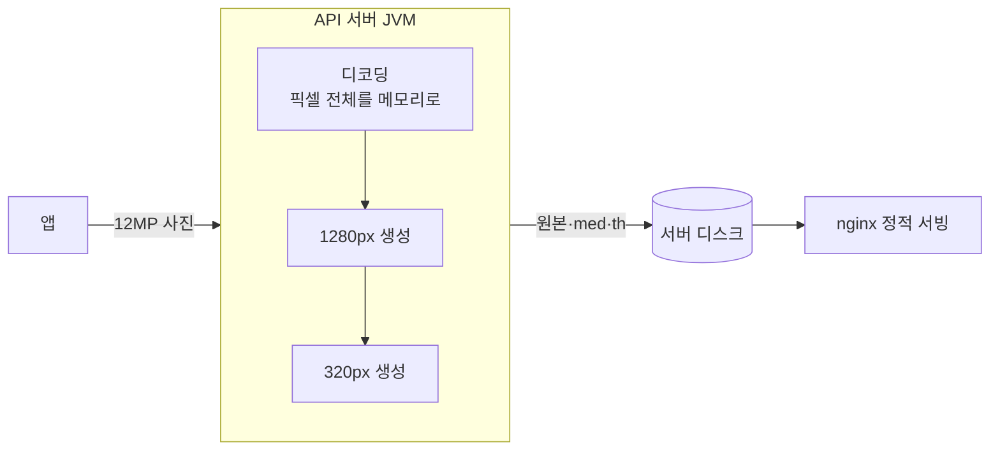
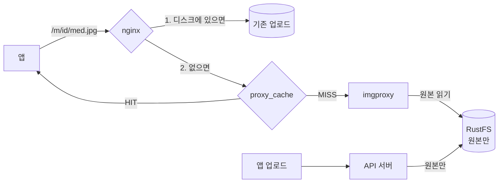

## 요약

- 예전에는 API 서버가 업로드를 받을 때마다 원본을 디코딩해 **두 가지 크기(1280px·320px)를 미리 만들고** 서버 디스크에 저장했습니다.
- 지금은 **원본만 S3 호환 저장소(RustFS)에 두고**, 크기 변환은 **imgproxy 가 처음 볼 때** 합니다. 결과는 nginx 가 디스크에 캐시합니다.
- 12MP 휴대폰 사진 기준으로 **업로드 p50 이 212ms → 107ms(-50%)** 로 줄었습니다. 대신 이미지를 처음 볼 때 변환 비용(약 35ms)이 한 번 듭니다.
- 이미지 URL 형식을 그대로 둬서 **앱을 다시 배포하지 않았습니다.** 기존 이미지도 옮기지 않고 그대로 나옵니다.

## 배경

푸차는 푸드트럭 지도 서비스입니다. 가게 대표 사진, 메뉴 사진, 리뷰·커뮤니티 사진이 화면 대부분을 차지합니다. 앱은 이미지를 이런 URL 로 받습니다.

```
/m/{mediaId}/{original|med|th}.{ext}
```

`mediaId` 는 파일 내용의 SHA-256 입니다. 같은 사진을 두 번 올리면 같은 ID 가 되고, **같은 URL 의 내용은 절대 바뀌지 않습니다.** 이 성질이 뒤에서 캐시를 단순하게 만듭니다.

## 문제

### 업로드가 API 서버의 일을 너무 많이 했다



업로드 한 번에 원본 디코딩과 리사이즈가 두 번 일어나고, 그동안 요청 스레드와 JVM 메모리를 잡습니다. 12MP 사진은 디코딩만으로 수십 MB 의 픽셀 버퍼가 필요합니다. 서버는 동시 디코딩 총량을 제한하는 세마포어로 메모리 폭주를 막고 있었고, 업로드 최대 픽셀도 메모리를 기준으로 정해야 했습니다(80MP → 20MP 로 낮춤).

### 크기가 업로드 시점에 고정된다

새 화면에 640px 썸네일이 필요해지면 **이미 올라온 모든 이미지**를 다시 만들어야 합니다. 일괄 작업을 만들고 돌리고 검증하는 비용이 듭니다.

### 저장소가 서버 한 대의 디스크에 묶여 있다

API 서버의 디스크가 곧 이미지 저장소였습니다. 서버를 늘리거나 옮기면 이미지도 함께 옮겨야 하고, 백업도 서버 디스크 백업에 섞여 있었습니다.

## 목표와 제약

- 업로드를 가볍게: API 서버는 **검증과 저장만** 한다.
- 크기는 나중에 바꿀 수 있게.
- **앱 수정 없이**: URL 형식과 업로드 응답을 바꾸지 않는다. 모바일 앱은 스토어 심사와 업데이트하지 않는 사용자 때문에 서버처럼 한 번에 바꿀 수 없다.
- **기존 이미지 마이그레이션 없이** 시작할 수 있게.
- 작은 팀, 서버 한 대 — 관리할 구성요소를 최소로.

## 검토한 대안

| 대안 | 장점 | 고르지 않은 이유 |
|---|---|---|
| 지금 구조 유지 + 리사이즈를 비동기 작업으로 | 변경이 작다 | 크기 고정·디스크 종속 문제는 그대로 |
| 클라우드 이미지 서비스(관리형 CDN 변환) | 운영 부담이 가장 적다 | 사용량 과금, 외부 서비스 종속. 현재 규모에서는 과하다 |
| **원본 저장소 + 요청 시점 변환 + 캐시** | 업로드가 가볍고 크기를 언제든 바꾼다 | 첫 조회가 느리다 → 캐시로 상쇄 |

세 번째를 골랐습니다. 구성요소는 셋입니다.

- **RustFS**: S3 호환 객체 저장소입니다. S3 API 로만 쓰기 때문에 나중에 다른 S3 호환 저장소나 클라우드 S3 로 바꿔도 코드가 같습니다. 비교적 새 프로젝트라는 위험은 이 호환성으로 줄였습니다.
- **imgproxy**: 요청 URL 에 크기를 담아 보내면 원본을 읽어 줄여 주는 변환 서버입니다. libvips 기반이라 JVM 리사이즈보다 메모리를 적게 씁니다.
- **nginx `proxy_cache`**: 이미 앞단에 있는 nginx 에 변환 결과를 캐시합니다. 새 구성요소가 아닙니다.

## 설계



### 1. 업로드는 검증하고 원본만 올린다

확장자·Content-Type·픽셀 수·디코딩 가능 여부 검증은 그대로 두고, 리사이즈를 지웠습니다. 저장 방식은 설정 하나(`media.storage=local|s3`)로 바꿀 수 있게 해서, 문제가 생기면 예전 방식으로 바로 돌아갈 수 있습니다.

```java
if (objectStore != null) {   // media.storage=s3
    objectStore.putIfAbsent(MediaObjectStore.originalKey(shaHex, ext), tmpFile, contentTypeOf(ext));
    return uploadResult(shaHex, ext, started);   // 응답 URL 형식은 예전과 같다
}
// local: 예전처럼 디스크에 원본·med·th 생성
```

### 2. nginx: 디스크 먼저, 없으면 imgproxy

```nginx
location ~ "^/m/(?<media_id>[0-9a-f]{64})/(?<media_variant>original|med|th)\.(?<media_ext>jpg|png|gif|webp)$" {
    root /app/data/images;
    try_files /$media_id/$media_variant.$media_ext @imgproxy;   # 기존 이미지는 디스크에서
}
```

`try_files` 한 줄 덕분에 **기존 이미지를 옮기지 않아도** 됩니다. 디스크에 있으면 예전처럼 주고, 없으면(새 업로드) imgproxy 로 넘깁니다. 원본을 저장소로 옮기는 스크립트도 만들었지만 선택 사항입니다.

### 3. 캐시 적중률을 위한 결정들

| 결정 | 이유 |
|---|---|
| 크기를 **두 가지 프리셋**(1280·320)으로 고정 | 임의 크기를 받으면 캐시 키가 끝없이 늘어난다 |
| 출력 형식을 **확장자로 고정** | `Accept` 헤더로 WebP·AVIF 를 고르면 같은 URL 이 여러 벌로 캐시된다 |
| `proxy_cache_lock on` | 같은 이미지가 동시에 비면 imgproxy 에는 한 요청만 |
| `Cache-Control: immutable`, 30일 | mediaId 가 내용 해시라 내용이 바뀌지 않는다 |
| 404 는 1분만 캐시 | 업로드 직후 조회가 엇갈려도 곧 다시 찾는다 |

```nginx
location @imgproxy {
    set $imgproxy_opts "rs:fit:1280:1280";
    if ($media_variant = th)       { set $imgproxy_opts "rs:fit:320:320"; }
    if ($media_variant = original) { set $imgproxy_opts "raw:1"; }   # 원본은 변환 없이 그대로
    proxy_pass http://imgproxy/_/$imgproxy_opts/plain/s3://pucha-media/$media_id/original.$media_ext@$media_ext;
    proxy_cache media;
    proxy_cache_key "$media_id/$media_variant.$media_ext";
    proxy_cache_lock on;
}
```

### 4. imgproxy 를 외부에 열지 않는다

imgproxy 는 URL 서명(키·솔트)으로 아무나 임의 변환을 요청하지 못하게 할 수 있습니다. 하지만 nginx 는 요청마다 HMAC 서명을 계산하기 어렵습니다. 그래서 다른 방법으로 같은 목표를 이뤘습니다.

- imgproxy 는 내부 네트워크에만 둡니다(포트를 열지 않음).
- nginx 는 **정규식으로 검증한 mediaId 와 정해진 크기만** URL 에 넣습니다.
- imgproxy 는 `s3://pucha-media/` 밖의 원본을 거부합니다(`IMGPROXY_ALLOWED_SOURCES`). 외부 URL 을 끌어오는 SSRF 를 막습니다.

## 검증

설정을 문서만 보고 쓰지 않았습니다. imgproxy 가 마침 메이저 버전(v4)이 바뀐 직후였기 때문입니다. 실제 컨테이너를 띄워 다음을 확인했습니다.

- `med` 는 1280px, `th` 는 320px 로 나오고, 두 번째 요청부터 `X-Cache-Status: HIT` 다.
- `original` 은 업로드한 바이트와 정확히 같다(`raw:1`).
- 디스크의 기존 이미지는 imgproxy 를 거치지 않는다.
- 없는 이미지, 허용하지 않은 크기, `../` 경로는 404 다.

자동화 테스트로는 실제 Postgres·RustFS 컨테이너에 업로드해 원본이 버킷에 들어가는지 확인합니다.

## 결과

**측정 환경**: Apple M5, Colima VM(4 vCPU / 6GiB) 안에 API·DB·저장소를 모두 띄웠습니다. 12MP(4032×3024) JPEG 10장을 썼고, 사진은 실제 휴대폰 사진처럼 압축되도록 센서 노이즈를 섞었습니다(평균 2.35MB). 개선 전은 같은 코드에서 저장 방식만 `local` 로 둔 것입니다.

| 항목 | 개선 전 | 개선 후 |
|---|---|---|
| 업로드 p50 | 211.6 ms | **106.5 ms (-50%)** |
| 이미지 1장 저장 용량 | 2.49 MB (원본+med+th) | 2.35 MB (원본만, -6%) |
| med 첫 조회 p50 | 1.9 ms (디스크) | 34.8 ms (imgproxy 변환) |
| med 반복 조회 p50 | 1.8 ms | 1.2 ms (nginx 캐시) |

- 업로드는 리사이즈 두 번이 빠지면서 **절반**이 됐습니다.
- 저장 용량 절감은 작습니다. 12MP 원본이 용량 대부분을 차지하고 축소본은 작기 때문입니다. 저장 측면의 이득은 용량보다 **"서버 디스크에서 독립된 저장소"** 에 있습니다.
- 첫 조회는 **약 33ms 느려졌습니다.** 비용을 업로드(모든 사진, 사용자가 기다림)에서 첫 조회(사진당 한 번, 이후 캐시)로 옮긴 것입니다.

## 트레이드오프와 남은 일

- **첫 조회 비용**: 인기 없는 이미지는 매번 "첫 조회"가 될 수 있습니다. 캐시는 30일·2GB 입니다. 지표를 보고 조정합니다.
- **운영 구성요소가 늘었다**: RustFS·imgproxy 두 컨테이너가 늘었습니다. 배포 스크립트가 앱보다 먼저 이들을 띄우고 healthy 를 기다리게 했고, 키가 빠진 채로 배포가 시작되지 않도록 사전 점검을 넣었습니다.
- **형식 최적화는 아직**: WebP·AVIF 자동 변환은 캐시 키를 늘려서 이번에는 넣지 않았습니다. 프리셋에 형식을 명시하는 방식으로 다시 검토할 계획입니다.

## 마치며

"썸네일은 업로드할 때 만든다"는 오래된 기본값을 바꾼 작업이었습니다. 이 작업을 가능하게 한 것은 새 기술보다 **URL 의 내용이 절대 바뀌지 않는다는 성질**(내용 해시 ID)이었습니다. 덕분에 캐시 무효화를 고민할 필요가 없었고, URL 을 그대로 둔 채 뒤쪽 구조만 바꿀 수 있었습니다.
