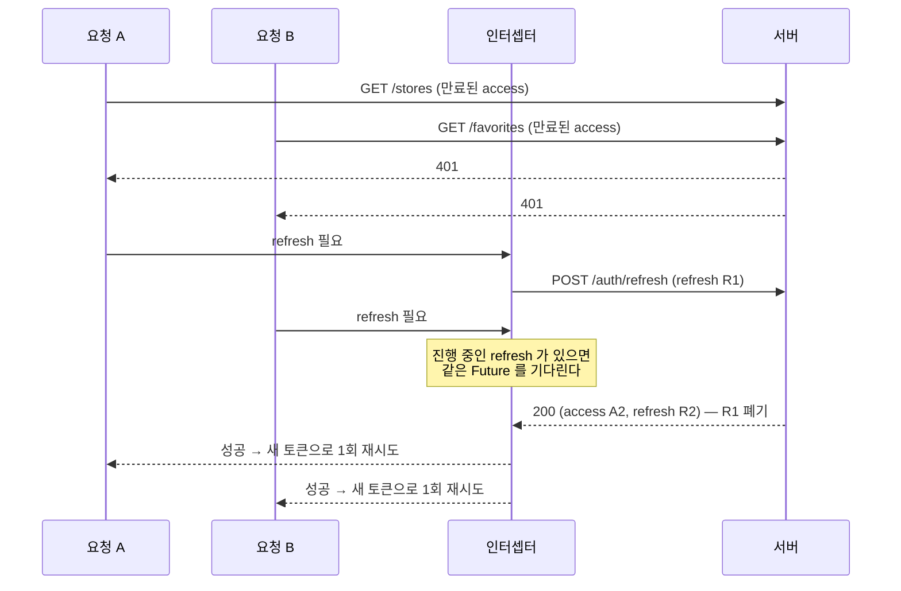

## 요약

- 서버가 refresh 토큰을 **1회용(회전)** 으로 바꾸자, 앱에서 "멀쩡히 쓰다가 갑자기 로그아웃되는" 문제가 생길 수 있는 조건이 세 가지 생겼습니다.
- 동시에 터지는 401 을 **refresh 한 번으로 합치고**, 갱신 실패 시 **"다른 요청이 이미 갱신했는지"** 를 저장소의 토큰을 비교해 판별했습니다.
- refresh 를 GET → POST 로 옮길 때 운영 서버가 아직 GET 만 받는 상황을 **405 → GET 폴백**으로 넘겼습니다. 405 가 토큰을 소비하지 않는다는 것을 서버 코드로 먼저 확인했습니다.

## 배경

푸차는 푸드트럭 위치를 보여주는 고객앱과 트럭을 운영하는 사장앱(둘 다 Flutter)이 같은 API 서버를 씁니다. 인증은 짧은 수명의 access 토큰과 긴 수명의 refresh 토큰으로 합니다.

서버가 보안 강화의 일환으로 refresh 토큰을 **회전(rotation)** 방식으로 바꿨습니다. refresh 토큰으로 새 토큰 쌍을 받으면 **방금 쓴 refresh 토큰은 폐기**됩니다. 탈취된 refresh 토큰이 재사용되면 바로 드러나도록 하는 표준적인 방식입니다.

문제는 이 변경이 서버만의 일이 아니라는 점이었습니다.

## 문제: 1회용 토큰이 만드는 세 가지 함정

### 1. 동시 401

홈 화면은 여러 API 를 동시에 부릅니다. access 토큰이 만료된 순간이면 그 요청들이 **동시에 401** 을 받고, 각자 refresh 를 시도합니다. 회전 방식에서는 첫 refresh 만 성공하고 나머지는 "이미 쓴 토큰"으로 거절됩니다.

### 2. 실패 처리가 새 토큰을 지운다

거절된 요청이 "refresh 실패 = 세션 끝"으로 판단하고 저장소를 비우면, **방금 다른 요청이 저장한 새 토큰까지 지워집니다.** 사용자는 정상인데 로그아웃됩니다. 코드 리뷰에서 실제로 이 경로가 발견됐습니다.

### 3. 앱이 서버보다 먼저 나간다

refresh 는 상태를 바꾸는 요청이라 POST 가 맞습니다. 서버 main 브랜치는 POST 를 열었지만 **운영 서버는 아직 GET 만** 받았습니다. 모바일 앱은 스토어 심사 때문에 배포 시점을 서버와 맞추기 어렵습니다. 앱이 POST 만 보내면, 운영 서버 배포 전까지 **모든 사용자의 토큰 갱신이 405 로 실패**합니다.

## 목표와 제약

- 정상 사용자가 토큰 만료 때문에 로그아웃되는 일이 없어야 합니다.
- 서버 배포 순서에 앱이 묶이지 않아야 합니다(어느 쪽이 먼저 나가도 동작).
- 진짜로 세션이 끝났을 때는 확실히 로그인 화면으로 보내야 합니다(무한 재시도 금지).

## 설계



### 1. 동시 401 → refresh 한 번 (single-flight)

진행 중인 refresh 를 `Future` 하나로 들고, 나중에 온 요청은 새로 시도하지 않고 그것을 기다립니다.

```dart
// refresh는 동시에 1회만 — 나머지 요청은 같은 Future를 공유
final refreshed = await (_refreshFuture ??=
    refreshToken().whenComplete(() => _refreshFuture = null));
if (refreshed) {
  requestOptions.extra['tokenRetried'] = true; // 요청당 재시도 1회 (무한 401 루프 방지)
  return handler.resolve(await _retry(requestOptions));
}
```

### 2. 실패해도 "누가 이미 갱신했는지" 먼저 본다

앱 안에서 합쳐도 **합치기 전에 이미 출발한 갱신**이나 인터셉터 밖의 경로가 먼저 성공할 수 있습니다. 그래서 실패 판정 전에 저장소의 refresh 토큰이 **내가 보낸 것과 같은지** 비교합니다.

```dart
Future<bool> _handleRefreshFailure(String? sentRefreshToken) async {
  final current = await LocalRepository().getRefreshToken();
  if (current != null && current.isNotEmpty && current != sentRefreshToken) {
    return true; // 다른 경로가 이미 갱신했다 — 지우지 않고 성공으로 처리
  }
  await LocalRepository().clearSharePreferencesWithoutOnboardState();
  return false;  // 아무도 갱신하지 못했다 — 진짜 세션 만료
}
```

### 3. POST 먼저, 405 면 GET

```dart
Future<Response> _requestRefresh() async {
  try {
    return await _dio.post(ApiUrls.API_AUTH_REFRESH);
  } on DioException catch (e) {
    if (e.response?.statusCode != 405) rethrow;
    return await _dio.get(ApiUrls.API_AUTH_REFRESH);
  }
}
```

이 폴백은 **"405 가 refresh 토큰을 소비하지 않는다"** 는 전제가 있어야 안전합니다. 소비한다면 GET 재시도는 이미 폐기된 토큰을 보내게 됩니다. 그래서 코드를 넣기 전에 서버 소스에서 세 가지를 확인했습니다.

| 확인한 것 | 왜 |
|---|---|
| 보안 설정에서 refresh 경로가 인증 필터를 통과(permitAll) | 405 판정 전에 토큰을 읽는 필터가 없는지 |
| 요청 제한 필터가 401·403 만 실패로 센다 | 405 가 실패 횟수에 쌓여 차단되지 않는지 |
| 405 는 스프링이 핸들러를 찾기 전에 내는 응답 | 토큰 회전 코드(핸들러)에 닿지 않는지 |

세 가지가 모두 맞아서, 운영 서버가 GET 만 받는 동안에도 갱신은 한 번에 성공합니다. 서버가 POST 를 받는 버전으로 배포되면 폴백과 서버의 GET 을 함께 지웁니다.

## 로그아웃도 같은 원칙으로

로그아웃은 서버에 refresh 토큰 폐기를 요청합니다(`POST /auth/logout`, refresh 토큰을 Bearer 로 보냄). 함께 푸시 기기 해제도 하는데, 기기 해제는 **access 토큰**이 필요하므로 순서가 중요합니다.

```dart
await _unregisterThisDevice();  // 1) access 토큰으로 이 설치의 푸시 해제
await _revokeServerSession();   // 2) refresh 토큰 폐기
clearSessionScopedCaches();     // 3) 로컬 정리
```

두 서버 호출은 모두 **베스트에포트**입니다(3초 제한, 실패해도 진행). 사용자가 로그아웃을 눌렀으면 그 기기에서는 반드시 로그아웃돼야 하기 때문입니다.

## 결과

- 동시 401 이 몇 개가 나든 refresh 는 1번만 나갑니다.
- 갱신 경합에서 새 토큰을 지우던 경로가 없어졌습니다.
- 앱과 서버의 배포 순서가 독립적이 됐습니다. 서버가 POST 를 받든 GET 만 받든 갱신은 한 번에 끝납니다.

## 한계와 다음 과제

- 405 폴백은 **임시 코드**입니다. 서버가 운영에 POST 를 연 뒤 지워야 하는데, 언제 지울지 잊기 쉽습니다. 코드 주석에 제거 조건을 적어 두었고, 서버 변경 영향 분석 도구가 이를 다시 알려주게 했습니다([6편](/posts/ai-api-impact-agent/)).
- 회전 이전에 발급된(jti 가 없는) 옛 refresh 토큰은 서버가 거부합니다. 해당 사용자는 한 번 다시 로그인해야 했습니다.

## 마치며

토큰 회전은 서버 한 줄 설정처럼 보이지만, 클라이언트에는 동시성 문제를 남깁니다. "실패했다"는 판단을 내리기 전에 **"정말 아무도 성공하지 못했나"** 를 확인하는 습관이 이번 작업의 핵심이었습니다.
