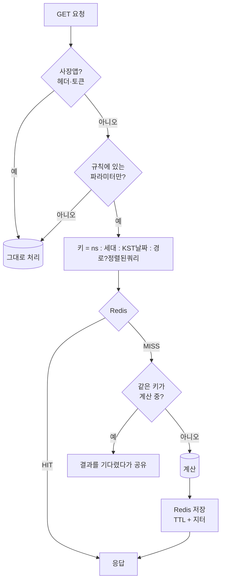

## 요약

- 홈 지도 API(가게 목록)는 요청마다 DB 쿼리 20개를 실행했고, 20명이 동시에 부르면 p50 이 319ms 였습니다.
- 공개 조회 응답을 **HTTP 응답째로 Redis 에 캐시**했습니다. 적중률을 높이려고 여섯 가지를 함께 설계했습니다.
  - 키에서 사용자를 뺍니다.
  - 쿼리 파라미터를 정규화합니다.
  - 같은 키의 동시 미스를 한 요청으로 묶습니다(single-flight).
  - TTL 에 지터를 섞습니다.
  - 세대 번호로 무효화합니다.
  - 사장앱 요청은 캐시를 거치지 않습니다.
- 로컬 측정에서 가게 목록의 **처리량은 60 → 2,275 req/s(약 38배), p95 는 505 → 15ms** 가 됐습니다. 캐시가 막 비었을 때 같은 요청 100개가 몰려도 DB 쿼리는 **2,000 → 218개**였습니다.

## 배경

푸차 고객앱을 열면 지도에 근처 푸드트럭이 뜹니다. 이 화면이 부르는 `GET /v1/store/list` 는 가게 수백 개의 카드 정보와 리뷰 통계, 오늘 영업 시간을 모아 돌려줍니다. 앱 사용의 시작점이라 트래픽이 가장 몰리는 API 입니다.

중요한 점은 **이 응답이 사용자마다 다르지 않다**는 것입니다. 지도에 뜨는 가게 목록은 누가 보든 같습니다. 그런데 서버는 요청마다 같은 계산을 다시 하고 있었습니다.

## 문제

**측정 환경**: Apple M5, Colima VM(4 vCPU / 6GiB) 안의 API·Postgres. 더미 가게 206개. k6 로 20명의 동시 사용자가 30초간 같은 API 를 계속 부릅니다.

| API | 처리량 | p50 | p95 | 요청당 DB 쿼리 |
|---|---|---|---|---|
| 가게 목록 | 60 req/s | 319 ms | 505 ms | 20 |
| 가게 상세 요약 | 707 req/s | 27 ms | 48 ms | 14 |
| 축제 목록 | 1,541 req/s | 12 ms | 21 ms | 4 |

가게 목록은 응답이 약 237KB 이고, 직렬화 비용까지 더해져 동시 사용자 20명만으로 p50 이 300ms 를 넘었습니다.

## 목표와 제약

- 같은 응답을 다시 계산하지 않는다.
- **사장이 영업 상태를 바꾸면 고객에게 바로 보여야 한다.** "영업 중인 줄 알고 갔는데 닫혀 있다"는 이 서비스에서 가장 나쁜 경험이다.
- 사장앱은 같은 경로에서 편집용 `version` 을 읽어 **낙관적 잠금**에 쓴다. 낡은 값을 받으면 저장이 409 로 실패한다.
- Redis 가 죽어도 API 는 살아 있어야 한다.

## 왜 `@Cacheable` 이 아니라 응답 캐시인가

처음 떠올린 것은 서비스 메서드에 `@Cacheable` 을 붙이는 것이었습니다. 두 가지가 걸렸습니다.

1. 응답 DTO 일부가 스프링의 `Page` 를 감싸고 있어 JSON 으로 저장한 뒤 **다시 객체로 만들 수 없었습니다.**
2. 캐시에서 꺼낸 DTO 를 다시 JSON 으로 직렬화하는 비용이 남습니다. 237KB 응답에서는 이 비용도 큽니다.

그래서 **직렬화가 끝난 응답 바이트**를 서블릿 필터에서 통째로 저장하기로 했습니다. 필터는 Spring Security 체인 **뒤**에 둬서, 인증·인가 판단은 캐시와 상관없이 그대로 돌게 했습니다.

## 설계: 적중률을 높이는 여섯 가지



### 1. 키에 사용자를 넣지 않는다

캐시할 경로를 **"사용자와 무관한 응답"으로 한정**했습니다. 그래서 키에 사용자 ID 가 없고, 모든 고객이 같은 키 하나를 나눠 씁니다. 즐겨찾기 목록이나 구독 여부처럼 개인 응답은 규칙에서 뺐습니다. 이것이 적중률에 가장 큰 영향을 줍니다.

### 2. 쿼리를 정규화하고, 모르는 파라미터는 캐시하지 않는다

`?page=0&status=ALL` 과 `?status=ALL&page=0` 은 같은 키가 되도록 이름순으로 정렬합니다. 그리고 경로마다 **허용된 파라미터 목록**을 둬서, 그 밖의 파라미터가 붙은 요청은 캐시를 거치지 않습니다. 의미 없는 파라미터(`?t=123`)로 키가 폭증하는 것을 막습니다.

### 3. 동시 미스는 한 번만 계산한다 (single-flight)

TTL 이 끝난 순간 요청 100개가 동시에 오면, 순진한 캐시는 DB 에 100번 갑니다(cache stampede). 키별로 "계산 중"인 작업을 하나만 두고 나머지는 그 결과를 기다립니다.

```java
CompletableFuture<CachedResponse> mine = new CompletableFuture<>();
CompletableFuture<CachedResponse> leader = inflight.putIfAbsent(key, mine);
if (leader != null) {                       // 누가 이미 계산 중이면
    CachedResponse shared = awaitLeader(leader);   // 최대 3초 기다렸다가 같은 결과를 쓴다
    ...
}
```

API 서버가 한 대라 JVM 안의 맵으로 충분했습니다. 서버가 늘면 Redis 락으로 바꿔야 하는 지점입니다.

### 4. TTL 에 지터를 섞는다

같은 시각에 만든 키들이 같은 시각에 만료되지 않도록 TTL 에 0~10% 를 더합니다.

### 5. 무효화는 키 삭제가 아니라 세대 번호로

사장이 가게를 바꾸면 그 가게뿐 아니라 **목록·축제 참여 트럭**처럼 그 가게를 포함한 응답도 바뀝니다. 영향받는 키를 찾아 지우는 대신, 네임스페이스마다 **세대 번호**를 두고 키에 넣었습니다.

```
pucha:rc:store:g41:2026-11-18:/v1/store/list
                ^^^ 세대
```

- 가게 쓰기가 성공하면 `INCR pucha:rc:gen:store` 한 번. 모든 가게 관련 키가 한꺼번에 무효가 됩니다. **O(1)** 입니다.
- 옛 세대 키는 아무도 읽지 않고, TTL 이 지나면 사라집니다.
- 세대 카운터는 TTL 이 없습니다. Redis 를 `volatile-lfu`(TTL 이 있는 키만 축출)로 띄워 **카운터가 축출되지 않게** 했습니다. 카운터가 0 으로 돌아가면 옛 값을 다시 읽게 되기 때문입니다.

무효화하는 쓰기와 하지 않는 쓰기를 구분했습니다.

| 쓰기 | 무효화 | 이유 |
|---|---|---|
| 가게 정보·메뉴·일정·영업 상태·공지 | ✅ | 고객이 바로 봐야 한다 |
| 리뷰 작성·삭제, 회원 탈퇴 | ✅ | 리뷰 수·가게 목록이 바뀐다 |
| 5분마다 자동 마감, 매일 축제 동기화 | ✅ | HTTP 밖의 쓰기 — 스케줄러가 직접 무효화 |
| 즐겨찾기 추가·삭제 | ❌ | 즐겨찾기 수만 바뀐다. 무효화하면 적중률이 크게 떨어진다 — TTL(60초)로 충분 |

키에 **한국 시간 날짜**도 넣었습니다. 응답에 "오늘 영업 시간"이 있어서 자정을 넘긴 값을 쓰지 않게 하기 위해서입니다.

### 6. 사장앱은 캐시를 거치지 않는다

고객앱과 사장앱은 같은 경로(`/v1/store/{id}`)를 씁니다. 사장앱은 응답의 `version` 을 받아 저장할 때 보내고, 서버는 그 값으로 동시 수정을 막습니다. 캐시가 낡은 `version` 을 주면 **사장의 저장이 409 로 실패**합니다.

그래서 nginx 가 사장 호스트에 붙이는 `X-Pucha-Client-App: vendor` 헤더나 사장 토큰이 있으면 캐시를 완전히 우회합니다. 캐시가 필요한 것은 트래픽이 큰 고객 쪽입니다.

### 그리고: Redis 가 죽어도

Redis 호출이 실패하면 캐시 없이 처리합니다(fail-open). 타임아웃은 200ms 로 짧게 잡았고, 경고 로그는 1분에 한 번만 남깁니다. 헬스 체크에도 Redis 를 넣지 않았습니다. 캐시 때문에 서비스가 내려가는 일은 없어야 합니다.

## 결과

같은 환경·같은 부하에서 캐시를 끈 상태(개선 전)와 켠 상태(개선 후)를 비교했습니다.

| API | 처리량 (req/s) | p50 (ms) | p95 (ms) | p99 (ms) | 요청당 DB 쿼리 |
|---|---|---|---|---|---|
| 가게 목록 | 60 → **2,275** | 319 → **6.6** | 505 → **14.7** | 733 → **79** | 20 → **2** |
| 가게 상세 요약 | 707 → **4,303** | 27 → **4.5** | 48 → **7.7** | 62 → **10** | 14 → **2** |
| 축제 목록 | 1,541 → **4,412** | 12 → **4.4** | 21 → **7.5** | 29 → **10** | 4 → **2** |

**캐시가 막 비었을 때 같은 요청 100개가 동시에** 오는 상황도 따로 쟀습니다.

- 개선 전: DB 쿼리 **2,000개** (요청당 20개 × 100)
- 개선 후: DB 쿼리 **218개** (가게 목록 계산 1번 = 18개 + 아래 인증 조회 200개)

single-flight 덕분에 실제 계산은 한 번만 일어났습니다.

### 남은 2개의 쿼리

캐시에 적중해도 요청당 쿼리가 2개 남습니다. 확인해 보니 **인증 필터가 요청마다 사용자를 조회**해 계정이 정지됐는지 보는 쿼리와 그 트랜잭션 시작이었습니다. 캐시는 업무 쿼리를 모두 없앴고, 다음 병목은 인증입니다. 정지된 계정을 즉시 막아야 한다는 요구 때문에 쉽게 캐시할 수 없어서 별도 과제로 남겼습니다.

### 이 숫자를 읽는 법

- 로컬은 앱·DB·Redis 가 한 VM 에 있어 네트워크 왕복이 거의 공짜입니다. 운영에서는 DB 왕복이 더 비싸서 캐시 효과가 **더 크게** 나타날 것으로 예상합니다. 다만 아직 운영 수치는 없습니다.
- 운영에서는 nginx 의 IP 당 요청 제한이 있어 한 사용자가 이 처리량을 내지 않습니다. 이 측정은 **서버 한 대가 감당할 수 있는 양**을 비교한 것입니다.
- 적중률은 운영 로그에 10분마다 남도록 했습니다. 배포 후 실제 적중률로 이 글을 갱신하겠습니다.

## 마치며

캐시는 붙이는 것보다 **"무엇을 키에서 빼고, 언제 비우고, 누구에게는 주지 않을지"** 를 정하는 일이었습니다. 특히 사장앱 우회와 즐겨찾기 비무효화는 코드보다 **서비스를 이해해야** 내릴 수 있는 결정이었습니다. 숫자를 크게 만든 것은 Redis 가 아니라 이 결정들이었습니다.
